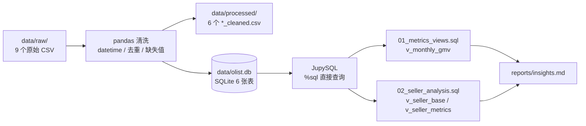

# Olist 电商营销数据深度分析（Python + SQL）

> 基于真实的巴西电商数据集（Olist），使用 **pandas** 完成数据清洗，使用 **SQLite + SQL** 完成业务指标建设与专题洞察，最终产出可直接落地的商业分析报告。


---

## 一、项目简介

本项目以 Olist（巴西最大电商平台之一）公开数据集为分析对象，覆盖 **2016-09 ~ 2018-09、共 24 个月的完整交易数据**。项目目标是模拟真实企业数据分析岗位的完整工作流：

**原始数据 → pandas 清洗入库 → SQL 指标视图 → 专题深度分析 → 商业报告**

项目不做零散的探索性分析，而是围绕两个真实业务课题展开：

| 课题 | 业务问题 | 产出 |
| --- | --- | --- |
| **核心指标建设** | 平台每月的真实交易规模有多大？如何定义"有效 GMV"？ | `v_monthly_gmv` 视图 |
| **专题深度分析** | 卖家发货慢是否真的导致差评？影响强度如何？该管谁？ | `v_seller_base` / `v_seller_metrics` 视图 + [分析报告](./reports/insights.md) |

### 数据规模

| 数据表 | 记录数 | 说明 |
| --- | ---: | --- |
| `orders_cleaned` | 99,441 | 订单主表（含 5 个业务时间节点） |
| `order_items` | 112,650 | 订单明细（卖家归属、商品金额、运费） |
| `payments` | 103,886 | 支付流水（一个订单可拆分多笔支付） |
| `reviews` | 99,224 | 客户评价（1~5 星） |
| `products` | 32,951 | 商品信息与品类 |
| `category_translation` | 71 | 品类名葡→英翻译 |

---

## 二、核心业务发现

### 2.1 交易规模：24 个月 GMV 达 1,573.9 万元

在剔除 `canceled` / `unavailable` 状态订单、并对支付流水做订单级聚合后：

- **有效订单 98,207 笔，累计 GMV 15,739,137.01 元**（含运费），覆盖 24 个月；
- 支付表存在一个订单拆分为多笔支付的情况（最多 29 笔/单），必须**先聚合再 JOIN**，否则 GMV 会被放大；
- 另有 1,234 笔已取消订单仍有支付记录，需在口径中剔除。

### 2.2 专题洞察：卖家发货时长是差评的核心可控驱动因素

针对「卖家履约质量与差评率」的关联分析，按卖家差评率用窗口函数 `NTILE(4)` 划分为 4 个服务质量等级，核心结论：

| 服务质量等级 | 卖家数 | 订单量 | 平均发货时长(h) | 客单价(元) | 差评率 |
| --- | ---: | ---: | ---: | ---: | ---: |
| **Tier 1**（最优） | 316 | 12,449 | **57.72** | 160.26 | **5.03%** |
| **Tier 2** | 315 | 29,341 | 64.05 | 164.61 | 10.57% |
| **Tier 3** | 315 | 32,260 | 76.83 | 133.71 | 15.27% |
| **Tier 4**（最差） | 315 | 19,459 | **109.07** | 163.28 | **24.05%** |

**关键结论：**

1. **时效与差评强相关**：从 Tier 1 到 Tier 4，发货时长增加 **89.0%**，差评率从 5.03% 升至 24.05%（**4.8 倍**）；卖家级相关系数 **r = 0.436**（n = 1,261），呈中强度正相关。
2. **排除价格因素的替代解释**：客单价与差评率相关系数仅 **0.101**，四档客单价无单调趋势（Tier 4 客单价 163.28 反而高于 Tier 1 的 160.26）——问题出在**履约动作**，而非商品定价。
3. **问题高度集中**：Tier 4 卖家仅占 **19.5% 的订单**，却贡献全站 **32.7% 的差评**；若将其差评率改善至 Tier 1 水平，预计可减少约 **3,660 条差评（全站 −25.9%）**。
4. **风险存在临界区间**：Tier 3 → Tier 4 发货时长仅增加 41.9%，差评率却跳升 57.5%，说明**超过约 100 小时后客户不满会加速累积**，为监控阈值提供依据。
5. **基础设施缺口普遍**：全站 **38.5% 的订单发货超 72 小时**，40.0% 的卖家平均发货超 72 小时；2017-11 大促期平均发货时长升至 97.8 小时，存在系统性挤兑。

> 完整的背景、方法、发现与建议见 **[reports/insights.md](./reports/insights.md)**。

---

## 三、技术栈

| 类别 | 技术 | 用途 |
| --- | --- | --- |
| 编程语言 | **Python 3.13** | 数据处理主语言 |
| 数据处理 | **pandas 3.1 / NumPy** | 类型转换、去重、缺失值处理、结果复算校验 |
| 数据库连接 | **SQLAlchemy 2.1** | `create_engine` 建立 SQLite 连接，`to_sql` 写入 |
| 数据库 | **SQLite 3.50** | 轻量本地数仓，无需额外部署 |
| SQL 分析 | **SQL（CTE / 多表 JOIN / 窗口函数 NTILE / ROW_NUMBER）** | 指标视图与分层建模 |
| Notebook SQL | **JupySQL 0.11** | 在 Jupyter 中直接用 `%sql` 写 SQL、结果一键转 DataFrame |
| 交互环境 | **Jupyter Notebook / VS Code** | 分析与结果展示 |

---

## 四、目录结构

```text
SQL+pandas项目分析/
├── main_analysis.ipynb          # 主分析 Notebook（5 个阶段，按顺序执行）
├── data/
│   ├── raw/                     # 原始 CSV（需自行下载，见「如何运行」）
│   ├── processed/               # 清洗后的 6 个 *_cleaned.csv
│   └── olist.db                 # SQLite 数据库：6 张表 + 3 个视图
├── sql/
│   ├── 01_metrics_views.sql     # 指标建设：v_monthly_gmv 月度 GMV 视图
│   └── 02_seller_analysis.sql   # 专题分析：v_seller_base / v_seller_metrics 视图
├── reports/
│   └── insights.md              # 商业分析报告（背景 / 方法 / 发现 / 建议）
├── scripts/
│   ├── __init__.py              # 包声明，便于 Notebook 中 import
│   └── data_cleaning.py         # 数据清洗入库脚本（可独立运行 / 可被 Notebook 调用）
├── requirements.txt             # 依赖清单
├── .gitignore                   # 忽略 data/、.venv/ 等
└── README.md
```

### 各文件夹职责

| 路径 | 作用 |
| --- | --- |
| `data/raw/` | **数据入口**。存放 Olist 官方 9 个原始 CSV，只读、不修改 |
| `data/processed/` | **清洗产物**。6 个 `*_cleaned.csv`（`utf-8-sig` 编码，Excel 可直接打开），便于人工核验与二次分发 |
| `data/olist.db` | **分析底座**。所有 SQL 都跑在这个库上，表与视图定义见下节 |
| `sql/` | **SQL 资产**。所有业务逻辑以 `.sql` 文件沉淀，与 Notebook 解耦，便于评审与版本管理 |
| `reports/` | **交付物**。面向业务方的分析报告，结论先行、数据支撑、含落地建议 |
| `scripts/` | **代码资产**。数据清洗与入库逻辑全部封装在此，Notebook 只做调用，保证「脚本可独立运行、逻辑可被复用」 |

### 数据库对象

**表（6 张，均由 pandas 写入）**

| 表名 | 行数 | 来源 |
| --- | ---: | --- |
| `orders_cleaned` | 99,441 | `olist_orders_dataset.csv` |
| `payments` | 103,886 | `olist_order_payments_dataset.csv` |
| `order_items` | 112,650 | `olist_order_items_dataset.csv` |
| `reviews` | 99,224 | `olist_order_reviews_dataset.csv` |
| `products` | 32,951 | `olist_products_dataset.csv` |
| `category_translation` | 71 | `product_category_name_translation.csv` |

**视图（3 个，由 SQL 定义）**

| 视图名 | 行数 | 说明 |
| --- | ---: | --- |
| `v_monthly_gmv` | 24 | 按月聚合的有效订单数与 GMV |
| `v_seller_base` | 99,542 | 订单 × 卖家粒度明细（评论去重、发货时长计算） |
| `v_seller_metrics` | 1,261 | 卖家级指标 + `NTILE(4)` 服务质量分层 |

---

## 五、分析流程

`main_analysis.ipynb` 共 5 个阶段，**必须按顺序执行**（后一阶段依赖前一阶段的数据库产物）：

| 阶段 | 内容 | 关键产出 |
| --- | --- | --- |
| **一** | 调用 `scripts/data_cleaning.py` 的 `process_orders()`：5 个时间字段转 `datetime`、缺失值按业务口径处理 | `orders_cleaned` 入库 |
| **二** | 调用 `process_secondary_tables()` 配置驱动批量处理其余 5 张表：循环清洗、去重、入库 | `payments` / `order_items` / `reviews` / `products` / `category_translation` |
| **三** | 配置 JupySQL：`%load_ext sql` + 连接 `data/olist.db` | 可在 Notebook 内直接写 SQL |
| **四** | 执行业务 SQL：月度 GMV 视图构建与查询 | `v_monthly_gmv` |
| **五** | 专题分析：卖家履约质量与差评率关联，结果转 DataFrame | `v_seller_base` / `v_seller_metrics` |

> 第一、二阶段的清洗代码不写在 Notebook 里，而是统一封装在 `scripts/data_cleaning.py`，
> Notebook 中只保留 `from scripts.data_cleaning import ...` + 函数调用，便于复用与独立运行。



---

## 六、如何运行

### 步骤 1：准备原始数据

本项目**不随仓库分发数据**（`data/` 已在 `.gitignore` 中忽略）。请先下载数据集：

1. 前往 Kaggle 下载 **Brazilian E-Commerce Public Dataset by Olist**；
2. 将解压后的 CSV 全部放入 `data/raw/`，共需以下 9 个文件：

```text
data/raw/
├── olist_orders_dataset.csv              # 必需（第一阶段）
├── olist_order_payments_dataset.csv      # 必需（第二阶段）
├── olist_order_items_dataset.csv         # 必需
├── olist_order_reviews_dataset.csv       # 必需
├── olist_products_dataset.csv            # 必需
├── product_category_name_translation.csv # 必需
├── olist_customers_dataset.csv           # 可选
├── olist_sellers_dataset.csv             # 可选
└── olist_geolocation_dataset.csv         # 可选（体积较大）
```

> 说明：Notebook 当前只消费前 6 个文件；另 3 个是数据集自带文件，本阶段未使用。

### 步骤 2：创建虚拟环境并安装依赖

```bash
# 创建虚拟环境
python -m venv .venv

# 激活（Windows PowerShell）
.venv\Scripts\Activate.ps1
# 激活（macOS / Linux）
source .venv/bin/activate

# 安装依赖
pip install -r requirements.txt
```

### 步骤 3：运行 Notebook

```bash
jupyter notebook main_analysis.ipynb
```

或用 VS Code 打开 `main_analysis.ipynb`，选择 `.venv` 解释器后 **从上到下顺序执行全部单元格**（`Run All`）。

Notebook 里的数据清洗单元格只是对脚本的调用，等价于直接执行：

```bash
# 独立跑完全部 6 张表的清洗与入库（含入库校验）
python scripts/data_cleaning.py
```

执行完成后将自动生成：

- `data/processed/*_cleaned.csv`（6 个清洗文件）
- `data/olist.db`（6 张表 + 3 个视图）

### 步骤 4（可选）：命令行方式验证

```bash
# 一键重跑并校验 Notebook（无报错即视为通过）
jupyter nbconvert --to notebook --execute --inplace main_analysis.ipynb
```

---

## 七、常见问题

**Q1：SQL 文件里有中文注释，用 `%sql --file` 执行报 `UnicodeDecodeError: 'gbk' codec`？**

这是 Windows 环境下的已知问题：JupySQL 读取文件时未指定编码，会用系统默认 GBK 解析 UTF-8 中文注释。正确做法是先显式以 UTF-8 读取再交给 `%sql`：

```python
from pathlib import Path
sql_text = Path("sql/02_seller_analysis.sql").read_text(encoding="utf-8")
%sql {{ sql_text }}
```

**Q2：为什么 `%run ./sql/xxx.sql` 不行？**

`%run` 是 Python 脚本执行器，无法解析 `.sql` 文件，会报 `SyntaxError: invalid decimal literal`。请使用上面的 `%sql {{ }}` 插值方式。

**Q3：JupySQL 查询结果只显示 10 行？**

这是 `SqlMagic.displaylimit` 的默认值，放宽即可：

```python
%config SqlMagic.displaylimit = 100
```

**Q4：如何把 SQL 结果交给 pandas 继续处理？**

```python
result = %sql SELECT * FROM v_monthly_gmv
df = result.DataFrame()   # 也可用 .dict() / .keys() / .scalar()
```

**Q5：`data/` 目录为什么不在 Git 里？**

原始数据与数据库合计上百 MB，已通过 `.gitignore` 排除，保持仓库轻量。协作者按「步骤 1」自行下载并重跑 Notebook 即可完整复现。

---

## 八、口径说明

为保证结论可复现，以下口径在全部 SQL 与报告中保持一致：

| 指标 | 口径定义 |
| --- | --- |
| 有效 GMV | 剔除 `canceled` / `unavailable` 状态订单后的 `SUM(payment_value)`，**含运费**；支付流水先按订单聚合再求和 |
| 发货时长 | `order_delivered_carrier_date − order_purchase_timestamp`，单位小时；衡量**卖家侧备货与交运**，不含干线运输与末端派送 |
| 差评 | `review_score ≤ 2` |
| 差评率 | 差评订单数 ÷ **有评论订单数**（分母剔除无评论订单，避免因评论缺失低估） |
| 卖家准入 | 仅纳入 `订单数 ≥ 10` 的卖家（1,261 个），覆盖全站 94.0% 订单；排除仅 1 单卖家（差评率只能是 0% 或 100%，会污染分位） |
| 时效异常值 | 剔除负值（承运商时间早于下单时间）与超 60 天的极端值，保留 `0 ~ 1,440` 小时 |
| 多卖家订单 | 明细按「订单 × 卖家」聚合金额，避免一单多卖家导致重复计数（1,278 笔） |
| 重复评论 | 同一订单多条评论时，保留 `review_answer_timestamp` 最新一条（547 笔订单存在多条，其中 202 笔评分矛盾） |

---

## 九、后续规划

- [ ] 接入 `products` / `category_translation`，补充**品类维度**的 GMV 与差评归因
- [ ] 构建**客户 RFM 分层**视图，识别高价值客群与流失风险
- [ ] 将 `scripts/` 扩展为**参数化 ETL 脚本**，支持月度增量刷新
- [ ] 增加**可视化看板**（趋势图、分层对比图），提升汇报表现力

---

## 参考

- 数据集：[Brazilian E-Commerce Public Dataset by Olist](https://www.kaggle.com/datasets/olistbr/brazilian-ecommerce)（Kaggle）
- 分析报告：[reports/insights.md](./reports/insights.md)
- SQL 脚本：[sql/](./sql)
